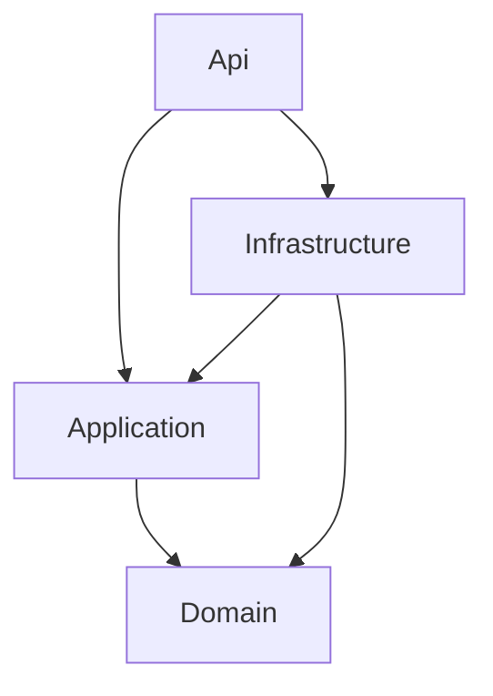

# VehicleCare — Quy tắc kỹ thuật và triển khai

**Phiên bản:** 1.0 — 14/10/2026  
**Áp dụng:** Frontend, backend, database, kiểm thử và triển khai VehicleCare.  
**Mục tiêu:** Monolith dễ hiểu, tuân thủ Clean Architecture, Clean Code và SOLID, đủ để hoàn thành đồ án.

## 1. Hiệu lực và cách sử dụng

- `spec.md` quy định chức năng, nghiệp vụ và tiêu chí nghiệm thu. `rules.md` quy định cách thiết kế và triển khai.
- Quyết định mới trong tài liệu này thay thế lựa chọn kỹ thuật cũ khi có xung đột: **Identity + JWT Bearer thay cookie authentication; Serilog làm logging provider; GitHub Actions cho CI/CD; Nginx cho production**.
- Các nội dung cookie/CSRF trong FR01, NFR02 và mục công nghệ của bản đặc tả cũ cần đồng bộ trước implementation. Tiêu chí thay thế là vòng đời token, thu hồi phiên và bảo vệ token tại mục 7; không tự thay nghiệp vụ khác.
- **Bắt buộc**: phải đáp ứng và kiểm tra trong review/CI. **Có điều kiện**: chỉ áp dụng khi có nhu cầu và quyết định được ghi lại. **Chưa dùng**: không đưa vào dependency hoặc môi trường mặc định.
- Các giá trị TTL, số lần retry hoặc lịch chạy nêu dưới đây là cấu hình ban đầu của dự án, không phải chuẩn bắt buộc của framework.
- Không tự thêm chức năng hoặc pattern chỉ để tăng số lượng công nghệ. Không tuyên bố đã kiểm thử hoặc triển khai khi chưa có bằng chứng.

## 2. Stack thống nhất

| Thành phần | Lựa chọn | Quy định |
|---|---|---|
| Frontend | React + TypeScript + Vite | SPA, bật TypeScript strict |
| Giao diện | Material UI bản cộng đồng | Một theme chung, không phụ thuộc thành phần trả phí |
| Routing | React Router | Route theo feature, protected route chỉ hỗ trợ UX |
| Dữ liệu API | TanStack Query | Quản lý server state, query key và invalidation |
| Form | React Hook Form + Zod | Validation FE; backend vẫn phải kiểm tra độc lập |
| HTTP | Fetch qua wrapper chung | Bearer header, timeout/cancellation, xử lý lỗi thống nhất |
| Biểu đồ | Chart.js + react-chartjs-2 | Có bảng đối chiếu dữ liệu |
| Backend | ASP.NET Core Web API, .NET 10 LTS | Controllers, DI, async, nullable reference types |
| Database | PostgreSQL 17 | Database quan hệ duy nhất trong giai đoạn đầu |
| ORM | EF Core 10 + Npgsql tương thích | Migrations, mapping và persistence ở Infrastructure |
| Authentication | ASP.NET Core Identity + JWT Bearer | Backend quản lý tài khoản, phát/kiểm tra token và phiên |
| API Documentation | OpenAPI + Swagger UI | Contract cập nhật cùng code, hỗ trợ Bearer authorization |
| Nhắc hạn | BackgroundService + PeriodicTimer | Mặc định; notification lưu PostgreSQL |
| Job framework | Hangfire | Có điều kiện, thay scheduler mặc định khi cần persistent job/retry dashboard |
| Logging | Serilog | Structured logging, ứng dụng dùng abstraction ILogger |
| Backend test | xUnit + integration tests | WebApplicationFactory và PostgreSQL test riêng |
| Frontend test | Vitest + React Testing Library | Kiểm tra hành vi component/form |
| E2E | Playwright | Các luồng nghiệp vụ trọng tâm |
| Môi trường | Docker Compose | Chạy toàn bộ hệ thống; có cấu hình dev/production |
| Reverse proxy | Nginx | Production: TLS, static frontend và proxy `/api` |
| CI/CD | GitHub Actions | Build, kiểm tra, test, tạo image và deploy có kiểm soát |
| Cache | Redis | Chưa dùng mặc định; bổ sung khi có nhu cầu đo được |

Pin SDK bằng `global.json`, pin package và commit lockfile. Kiểm tra major version tương thích của EF Core/Npgsql/Serilog integration; không mặc định mọi package có cùng major. Không dùng preview/beta hoặc Docker tag `latest` trong môi trường triển khai ổn định.

## 3. Clean Architecture bắt buộc

### 3.1. Ranh giới project

| Project | Nội dung được phép | Không được chứa |
|---|---|---|
| `VehicleCare.Domain` | Entity, value object, invariant, enum, policy/strategy thuần, domain event | EF Core, ASP.NET, IdentityUser, Serilog, SQL, HTTP, DI container |
| `VehicleCare.Application` | Use case/service, command/query khi cần, DTO, validation nghiệp vụ, interface, event handler | Infrastructure implementation, DbContext, IQueryable, HttpContext, HTTP status |
| `VehicleCare.Infrastructure` | DbContext, EF configuration, migration, repository/DAO, Identity adapter, token signer, job adapter | Quyết định nghiệp vụ độc lập làm sai lệch Domain/Application |
| `VehicleCare.Api` | Controller, middleware, authentication setup, HTTP mapping, OpenAPI, composition root | Truy vấn DB trực tiếp, tính hạn, tổng hợp chi phí hoặc business rule |

### 3.2. Chiều tham chiếu

Đường nối thể hiện **project reference**, không phải luồng request. `Api → Infrastructure` chỉ phục vụ đăng ký implementation tại composition root. Controller chỉ gọi Application contract. Domain không tham chiếu project nào; Application không tham chiếu Api/Infrastructure. Không có vòng phụ thuộc.

- Domain có `UserId` nhưng không kế thừa `IdentityUser`. Infrastructure chứa `ApplicationUser` và Identity store.
- Domain không phụ thuộc serializer, ORM attribute hoặc framework validation. EF Fluent Configuration nằm trong Infrastructure.
- Application dùng interface như `ICurrentUser`, `IClock`, `ITokenIssuer`, `IVehicleRepository`, `IReportQueries`.
- Api triển khai adapter lấy current user từ claims; Infrastructure cung cấp persistence/Identity/token implementation.
- Logging trong Application dùng `Microsoft.Extensions.Logging.Abstractions` nếu cần; không tham chiếu Serilog. Domain không ghi log qua framework.
- Một backend process, một PostgreSQL database. Chia project không đồng nghĩa chia service triển khai.

### 3.3. Tổ chức repository

| Đường dẫn | Nội dung |
|---|---|
| `frontend/src/app` | Router, providers, cấu hình app |
| `frontend/src/features/<feature>` | Page/component, API, hooks, schema và types theo nghiệp vụ |
| `frontend/src/shared` | UI/API/util thực sự dùng chung |
| `backend/src/VehicleCare.Domain` | Domain model và policy |
| `backend/src/VehicleCare.Application` | Features, contracts, services/handlers |
| `backend/src/VehicleCare.Infrastructure` | Persistence, Identity, jobs, integrations |
| `backend/src/VehicleCare.Api` | HTTP host |
| `backend/tests` | Domain/Application unit, integration và architecture tests |
| `deploy` | Dockerfile, Compose, Nginx và cấu hình mẫu |
| `docs` | Đặc tả, use case, ERD, quyết định kiến trúc |
| `.github/workflows` | CI/CD |

Không tạo thư mục `Helpers`, `Managers`, `Common` lớn chứa các nghiệp vụ không liên quan.

## 4. SOLID và Clean Code

| Nguyên tắc | Quy tắc áp dụng |
|---|---|
| Single Responsibility | Controller xử lý HTTP; service điều phối; evaluator tính hạn; repository truy cập dữ liệu |
| Open/Closed | Các mode bảo dưỡng dùng hợp đồng strategy ổn định; thêm mode không sửa controller hoặc sao chép luồng |
| Liskov Substitution | Implementation tuân thủ tiền/hậu điều kiện interface; không ném NotImplementedException cho hành vi đã hứa |
| Interface Segregation | Interface theo nhu cầu; báo cáo không bị buộc triển khai CRUD |
| Dependency Inversion | Tầng trong định nghĩa hợp đồng, tầng ngoài cung cấp implementation |

Quy tắc code:

1. Tên code bằng tiếng Anh, rõ nghiệp vụ. Tài liệu/UI tiếng Việt; lỗi có mã ổn định.
2. C# dùng PascalCase cho type/member, camelCase cho biến/tham số, hậu tố `Async` cho method bất đồng bộ.
3. TypeScript strict, hạn chế `any`; dữ liệu ngoài hệ thống dùng `unknown` và kiểm tra trước khi sử dụng.
4. Hàm ngắn, một mục đích; guard clause cho dữ liệu sai. Tách theo trách nhiệm, không chia hàm máy móc theo số dòng.
5. Không chặn async bằng `.Result`/`.Wait()`, không `async void` cho nghiệp vụ, truyền CancellationToken đến I/O.
6. Không catch rồi bỏ lỗi, trả thành công giả hoặc dùng exception cho mọi lỗi validation dự kiến.
7. Dùng constant/enum cho mã nghiệp vụ, configuration cho môi trường. Không hard-code secret hoặc endpoint production.
8. Comment giải thích lý do hoặc ràng buộc, không lặp lại câu lệnh.
9. Logic tính hạn, tiền và quyền phải có một nguồn thực thi ở backend. FE chỉ hỗ trợ nhập/hiển thị.
10. Formatter/linter và architecture tests là gate; code review đánh giá trách nhiệm, coupling và tính rõ ràng, không chỉ việc build thành công.

## 5. Design pattern và phạm vi áp dụng

### 5.1. Ma trận pattern

| Pattern | Áp dụng trong VehicleCare | Mức áp dụng |
|---|---|---|
| Repository | Load/save domain entity hoặc aggregate, như Vehicle, ServiceRecord, MaintenancePlan | Bắt buộc trên luồng ghi nghiệp vụ |
| Unit of Work | Commit transaction cho một use case qua DbContext scoped dùng chung | Bắt buộc, abstraction mỏng |
| Service Layer | Application services điều phối CRUD/use case, owner check, transaction | Bắt buộc |
| DAO | Truy vấn báo cáo/projection, ví dụ `ExpenseReportDao` triển khai `IReportQueries` | Dùng cho query tổng hợp; không nhân đôi CRUD repository |
| Dependency Injection | Inject contracts tại constructor, đăng ký ở composition root | Bắt buộc |
| DTO | Request/use-case input/response tách khỏi persistence entity | Bắt buộc |
| Strategy | Time, Distance, Either maintenance policies cùng hợp đồng | Áp dụng cho tính hạn |
| State | Lifecycle có hành vi chuyển trạng thái phức tạp nếu xuất hiện | Có điều kiện; hiện tại enum + transition method đủ |
| Factory | Tạo plan/record hợp lệ qua named/static factory; resolve strategy theo mode | Áp dụng tối giản, không tạo class factory cho mọi entity |
| Observer / Domain Events | Thông báo thay đổi nghiệp vụ nội bộ, ví dụ MaintenanceCompleted | Áp dụng có chọn lọc cho phản ứng nghiệp vụ |
| CQRS | Tách command/query cho hoàn thành bảo dưỡng, sửa lịch sử hoặc báo cáo phức tạp | Có điều kiện, cùng database |

Một enum trạng thái không phải GoF State pattern. Nếu chưa có state class/behavior độc lập thì báo cáo phải ghi đúng cách cài đặt. Không ép `Soon/Due/Overdue` thành state machine lưu DB vì đây là kết quả tính từ thời gian/ODO.

### 5.2. Repository, DAO và Unit of Work

- Interface repository/UoW/queries đặt trong Application; implementation trong Infrastructure.
- Repository không trả `DbSet`, `DbContext`, `IQueryable` ra ngoài. Trả entity, DTO/read model hoặc collection theo hợp đồng rõ.
- Repository thực hiện add/update/remove nhưng không tự commit. Application service/command handler sở hữu ranh giới commit.
- Các repository tham gia một use case dùng cùng DbContext scoped.
- DAO trả read model cho báo cáo, dùng projection và `AsNoTracking`. Không tạo chuỗi Repository → DAO → Repository chỉ để bọc EF.
- Một use case có một đơn vị thay đổi nhất quán. Explicit transaction khi cần nhiều SaveChanges hoặc nhiều bước phải atomic.
- Handler gọi trong transaction không tự mở transaction độc lập hoặc gọi SaveChanges lồng nhau.
- SQL đặc biệt nếu cần phải parameterized, nằm trong Infrastructure, có integration test.
- Không tạo `IGenericRepository<T>` với hàng chục method mặc định khi từng aggregate có nhu cầu khác nhau.

### 5.3. Service Layer và CQRS

- CRUD đơn giản như thông tin xe/cài đặt dùng service với method rõ: `CreateAsync`, `UpdateAsync`, `ArchiveAsync`.
- Nghiệp vụ phức tạp có thể dùng `CompleteMaintenanceCommand`, `UpdateServiceRecordCommand`, `GetExpenseReportQuery`.
- Một use case có một entry point Application; không vừa đặt nghiệp vụ trong service vừa sao chép vào command handler.
- Command thay đổi dữ liệu; query không phát sinh thay đổi nghiệp vụ.
- CQRS không bắt buộc MediatR, event sourcing, message broker hoặc database riêng.
- Tạo ADR ngắn trước khi thêm CQRS framework: vấn đề, lựa chọn, lợi ích, chi phí, phạm vi áp dụng.

### 5.4. Strategy, State và Factory

- Strategy nhận input thuần: plan, baseline/completion, ngày hiện tại và ODO. Không tự truy vấn DB hoặc gọi clock toàn cục.
- `Either` kết hợp hai kết quả theo quy tắc trong `spec.md`; không sao chép công thức Time/Distance.
- Factory kiểm tra dữ liệu cần thiết theo mode và bảo đảm entity không sinh ra ở trạng thái bất hợp lệ.
- Lifecycle đơn giản dùng method như `Archive`, `Restore`, `Pause`, `Resume`; kiểm tra invariant trong Domain.
- Chỉ nâng lên State classes khi mỗi trạng thái có hành vi khác biệt đáng kể. Không lưu trạng thái hạn tính toán như nguồn dữ liệu chân lý.

### 5.5. Observer và Domain Events

- Event là sự kiện nghiệp vụ đã xảy ra: `MaintenanceCompleted`, `OdometerRecorded`, `ServiceRecordChanged`.
- Domain định nghĩa event immutable và tập hợp event; không chứa DI container, dispatcher hoặc Infrastructure service.
- Application chứa dispatcher contract và handler. Dispatcher in-process có thể triển khai tại Application bằng dependency injection, không cần event bus.
- V1 xử lý những handler ảnh hưởng dữ liệu nhất quán **trước commit, trong cùng transaction**. Handler được await, không `Task.Run`/fire-and-forget.
- Các handler cập nhật lịch/notification phải idempotent; có một chủ sở hữu ranh giới dispatch/commit, tránh vòng lặp event.
- Không gửi email/push/network request trước commit. Nếu sau này cần gửi chắc chắn sau commit, dùng transactional outbox và worker; hiện tại chưa triển khai kênh ngoài.
- Worker định kỳ đánh giá lại notification là đường phục hồi từ dữ liệu DB, không phụ thuộc event in-memory còn tồn tại sau restart.
- Domain Event nội bộ không phải integration event và không tự bảo đảm giao nhận qua restart [R4].

## 6. Quy tắc frontend

- Một theme Material UI chung cho font, màu, spacing và trạng thái; ưu tiên component accessible.
- Route tổ chức theo feature. Protected route kiểm tra trạng thái phiên để điều hướng; backend vẫn quyết định quyền.
- Query key chứa các biến ảnh hưởng kết quả: xe, khoảng ngày, loại, page. Xóa cache khi đổi tài khoản.
- Mutation thành công invalidate/update đúng dữ liệu: activity, ODO, plan/status, notification và báo cáo liên quan.
- Không lưu bản sao cùng server state trong Redux/Context. Context chỉ giữ auth/session UI tối thiểu.
- React Hook Form giữ state form; Zod kiểm tra cấu trúc/định dạng, hiển thị server validation theo field.
- Khi edit, reset form theo dữ liệu đã tải có chủ đích; tránh ghi đè phần người dùng đang nhập khi refetch.
- Wrapper HTTP gắn Bearer header cho API tin cậy, xử lý `401/403/409`, cancellation và ProblemDetails.
- Refresh token chỉ chạy single-flight trong một tab. Retry request đã `401` tối đa một lần sau refresh; refresh thất bại thì clear auth/cache.
- Không tự retry mutation nếu không có cơ chế idempotency. Disable submit trong lúc pending chỉ là hỗ trợ UI.
- Không dùng `dangerouslySetInnerHTML` cho nội dung người dùng. Không nhúng secrets vào biến `VITE_*`.
- Có loading/empty/error/success, xác nhận xóa, label/đơn vị và focus bàn phím. Dùng được ở 360/768/1440px.

## 7. Authentication: Identity + JWT do backend quản lý

### 7.1. Quyết định

V1 dùng Identity lưu tài khoản/password hash trong PostgreSQL, backend phát **JWT access token** và **opaque refresh token** cho frontend riêng của VehicleCare. API nhận `Authorization: Bearer <access-token>`; không dùng cookie authentication hoặc cookie refresh token.

Đây là thiết kế xác thực giới hạn cho đồ án first-party, không phải một OAuth/OIDC authorization server. Khi mở cho ứng dụng bên thứ ba/SSO, phải đánh giá giải pháp OAuth/OIDC chuẩn thay vì mở rộng tùy ý cơ chế tự phát token.

**Identity không tự đồng nghĩa với JWT.** Token mặc định của `MapIdentityApi` không phải JWT chuẩn. Phải cấu hình JWT issuer/validation riêng bằng thư viện chuẩn và `AddJwtBearer`; không tự viết thuật toán ký [R1][R2].

### 7.2. Nơi lưu dữ liệu

| Dữ liệu | Nơi lưu / quy tắc |
|---|---|
| Tài khoản, password hash, lockout | Identity tables trong PostgreSQL |
| Phiên đăng nhập | `AuthSessions`: SessionId, UserId, CreatedAt, AbsoluteExpiresAt, RevokedAt |
| Refresh token | `RefreshTokens`: TokenHash duy nhất, SessionId, CreatedAt, ExpiresAt, ConsumedAt, RevokedAt, ReplacedById |
| Access JWT | Backend phát cho client, không lưu nguyên chuỗi JWT vào DB |
| Token ở frontend | Chỉ trong bộ nhớ của tab, ngoài persisted Query cache |
| Signing key | Secret của môi trường triển khai, không nằm trong source hoặc DB nghiệp vụ |

Không lưu token thô trong database/log. Refresh token ngẫu nhiên mật mã tối thiểu 32 byte; lưu hash SHA-256 của token ngẫu nhiên đó. Password vẫn dùng password hasher của Identity, không dùng SHA-256 trực tiếp cho mật khẩu.

Lưu phiên ở database **không thay thế** việc client cần giữ credential để gửi request. Với lựa chọn memory-only, reload/đóng tab làm mất token và phải đăng nhập lại. Đây là giới hạn UX chốt cho v1; không âm thầm chuyển token sang localStorage/sessionStorage/IndexedDB. Storage đọc được từ JavaScript làm tăng tác động của XSS [R3]. Memory-only cũng không loại bỏ XSS.

### 7.3. Luồng và cấu hình mặc định

1. **Login:** Identity kiểm tra password/lockout, tạo AuthSession và refresh token hash, trả access/refresh token qua HTTPS với `Cache-Control: no-store`.
2. **Access token:** TTL 15 phút, claims tối thiểu `sub`, `sid`, `jti`, `iss`, `aud`, `iat`, `exp`. Không chứa password hoặc dữ liệu nhạy cảm.
3. **Validation:** kiểm tra chữ ký, thuật toán được phép, issuer, audience, expiry và clock skew tối đa 30 giây. Không chấp nhận token unsigned hoặc chỉ decode payload để xác thực.
4. **Kiểm tra phiên:** sau JWT validation, API kiểm tra `sid` trong DB còn hiệu lực và thuộc `sub`. V1 chưa cache kiểm tra này; đổi lại logout có hiệu lực ở request tiếp theo.
5. **Refresh:** token TTL 7 ngày, không vượt hạn tuyệt đối của session 7 ngày. Khi sử dụng, tiêu thụ token cũ và tạo token mới trong transaction, không gia hạn session vô hạn.
6. **Reuse:** token đã dùng bị dùng lại thì thu hồi session cùng các refresh token thuộc session đó. Hai refresh cạnh tranh không được cùng thành công. FE single-flight giúp tránh race bình thường.
7. **Logout:** backend thu hồi session và refresh tokens; frontend xóa token/cache. JWT của session đã thu hồi bị từ chối từ request tiếp theo; request đã được xác thực và đang chạy không thể thu hồi ngược.
8. **Đổi mật khẩu:** kiểm tra mật khẩu cũ, thay đổi bằng Identity và thu hồi toàn bộ session người dùng, yêu cầu đăng nhập lại.

Mỗi tab đăng nhập tạo session riêng. Không triển khai “ghi nhớ đăng nhập qua reload” trong v1. Refresh response mất giữa đường có thể khiến retry bị coi là reuse và phải login lại; ưu tiên hành vi xác định thay vì nới rotation tùy tiện.

### 7.4. Endpoint và bảo vệ

- `POST /api/auth/register`, `/login`, `/refresh`, `/logout`, `/change-password`; `GET/PATCH /api/auth/me`.
- Refresh endpoint không yêu cầu access token còn hạn nhưng phải xác minh refresh token và session.
- Logout có thể dùng access token còn hợp lệ hoặc refresh token qua endpoint contract để thu hồi khi access đã hết hạn; không cho phép thu hồi chỉ bằng UserId/SessionId do client khai.
- Bearer gửi qua header không tự động đính kèm như cookie, nên cơ chế antiforgery cookie cũ không áp dụng cho các endpoint bearer-only. Nếu thêm cookie-auth sau này phải thiết kế lại CSRF.
- CORS allowlist rõ trong dev khi cần, production ưu tiên cùng origin. CORS không thay authentication hoặc ownership check.
- Rate limit login/register/refresh, thông báo login thất bại không tiết lộ tài khoản có tồn tại hay không.
- Không ghi token vào URL, log body auth, telemetry, Redux devtools hoặc browser storage. Swagger UI không bật persist authorization.

## 8. RESTful API và hợp đồng giao tiếp

- Dùng JSON, resource dạng danh từ số nhiều: `/api/vehicles`, `/api/fuel-records`, `/api/service-records`, `/api/maintenance-plans`.
- Dùng `GET` để đọc, `POST` để tạo, `PUT` cho cập nhật đầy đủ, `PATCH` khi có contract cập nhật từng phần, `DELETE` cho thao tác xóa được phép.
- Lifecycle có thể dùng action subresource rõ: `POST /api/vehicles/{id}/archive`; không dùng `GET` để thay đổi dữ liệu.
- API idempotency và business rule phải theo `spec.md`; có ResourceId không có nghĩa được phép truy cập.
- `201 + Location` khi tạo; `200/204` thành công; `400` validation; `401` token thiếu/sai/hết hạn/thu hồi; `403` thiếu quyền policy; `404` tài nguyên ngoài owner; `409` conflict; `429` rate limit; `500` lỗi bất ngờ.
- Response lỗi dùng ProblemDetails thêm `code`, `traceId`, `errors` theo field. Không trả exception/stack trace.
- Pagination mặc định 20, tối đa 100; sort ổn định; kiểm tra bộ lọc ngày/loại và chiều sort.
- Ngày nghiệp vụ `YYYY-MM-DD`, timestamp UTC ISO 8601; currency VNĐ nguyên, số lít tối đa 3 chữ số thập phân.
- Định nghĩa DTO riêng để chống over-posting; không nhận OwnerId, tổng chi phí hoặc trạng thái hạn từ FE như giá trị có thẩm quyền.
- Tài liệu OpenAPI phải có request/response, lỗi, pagination, Bearer scheme và ví dụ không chứa dữ liệu thật.
- Swagger UI bật dev/demo; production tắt mặc định hoặc bảo vệ rõ. Không dùng Swagger làm phương án phân quyền thay backend.

## 9. PostgreSQL, EF Core và nghiệp vụ VehicleCare

- Migration được commit, review và thử trên DB rỗng trước merge. Thay schema phải có phương án bảo toàn dữ liệu.
- DbContext scoped; không share giữa thread/request hoặc chạy các query song song trên cùng instance.
- Query đọc dùng projection/AsNoTracking, lọc owner và phân trang tại DB. Tránh N+1 và tải toàn bảng để lọc ở RAM.
- Dùng `decimal/numeric` cho tiền, `date` cho ngày nghiệp vụ, `timestamptz` cho timestamp kỹ thuật.
- Bắt buộc FK/check/unique cho các invariant có thể biểu diễn ở DB. Validation ở FE không thay constraint.
- Index cho owner, VehicleId/BusinessDate, MaintenancePlanId và notification/session lookup; bổ sung index dựa trên query thực tế.
- Update/delete có optimistic concurrency. Mutation ảnh hưởng ODO/lịch phải kiểm soát cạnh tranh theo xe trong transaction.
- RequestId tạo fuel/service và unique plan/cycle/severity cho notification phải có constraint chống race.
- Chi phí chỉ cộng FuelRecord và ServiceItem; không cộng thêm tổng ServiceRecord hoặc MaintenancePlan.
- ODO nhập bổ sung, hoàn thành plan và sửa/xóa lịch sử phải theo `spec.md`, có test tại các ngưỡng.
- Xe archive giữ lịch sử; reading nguồn không xóa độc lập; không cascade-delete mất lịch sử qua thao tác archive.
- Không lưu cache trạng thái `Due/Overdue` rồi coi đó là dữ liệu luôn đúng. Tính lại theo clock và ODO hiện hành.

## 10. Nhắc lịch và xử lý nền

### Mặc định: BackgroundService

- Worker nằm trong cùng monolith, gọi Application service, không viết nghiệp vụ vào vòng timer.
- Dùng PeriodicTimer 60 giây và quét khi khởi động; mỗi lượt có scope riêng, CancellationToken và xử lý lỗi.
- Không chạy chồng hai lượt cùng worker. Xử lý theo batch, tránh giữ transaction toàn bộ lịch của mọi người dùng.
- Notification lưu database; delivery ra trình duyệt là thao tác riêng sau commit.
- Server tắt thì worker không chạy; restart đánh giá lại hạn bị bỏ lỡ từ DB. Không dựa vào timer in-memory như dữ liệu lịch duy nhất.

### Hangfire: chỉ khi có nhu cầu

- Chỉ thay bằng Hangfire khi cần job lưu bền, retry quản lý hoặc dashboard và nhóm có thời gian tích hợp.
- Chọn PostgreSQL storage provider tương thích và đánh giá riêng mức hỗ trợ; không giả định Hangfire mặc định hỗ trợ mọi database.
- Không cho BackgroundService và Hangfire cùng lập lịch một nghiệp vụ.
- Job retry vẫn có thể lặp tác động, nên idempotency/unique constraint vẫn bắt buộc.
- Dashboard phải xác thực và giới hạn quyền; web host phải đang chạy để xử lý job nếu dùng chung process [R5].

## 11. Logging bằng Serilog

- Api cấu hình Serilog ở host; service dùng `ILogger<T>` qua DI. Không gọi static `Log` xuyên khắp nghiệp vụ.
- Log có cấu trúc bằng message template, ví dụ `Vehicle {VehicleId} archived`; không ghép chuỗi làm mất field.
- Console JSON trong container là sink mặc định. Rolling file chỉ thêm khi có volume, giới hạn dung lượng và retention rõ.
- Trường cần thiết: timestamp UTC, level, message, exception nếu có, traceId, request path/status/duration. UserId chỉ log khi cần, không dùng email làm định danh log mặc định.
- Không log password, access/refresh token, Authorization header, connection string hoặc toàn bộ request/response auth.
- Dùng request logging middleware; tránh ghi cùng exception nhiều lần qua mỗi layer.
- Worker log batch, số plan xử lý, lỗi và thời gian; không log một dòng mức Information cho mọi lần polling không có thay đổi.
- `Debug` cho dev; `Information`/`Warning`/`Error` cho production theo ý nghĩa thực tế. Healthcheck/polling có thể giảm mức để tránh nhiễu [R6].

## 12. Kiểm thử

| Loại | Công cụ / phạm vi bắt buộc |
|---|---|
| Domain unit | xUnit: từng Strategy, Either, cuối tháng, ODO, invariant, factory/transition |
| Application unit | Service/handler orchestration, ownership, lỗi nghiệp vụ, event handler |
| Integration | WebApplicationFactory + PostgreSQL test hoặc Testcontainers PostgreSQL; migration, constraint, transaction, API/auth |
| Architecture | Kiểm tra project reference, Domain/Application không tham chiếu framework bị cấm |
| Frontend | Vitest + React Testing Library: form, errors, mutation state, expired session |
| E2E | Playwright: thêm xe, ghi nhiên liệu, đến hạn, hoàn thành bảo dưỡng, báo cáo |

- Không dùng EF InMemory làm bằng chứng PostgreSQL transaction/constraint hoạt động.
- Test clock giả, seed xác định và database cô lập; không phụ thuộc dữ liệu máy cá nhân.
- Bắt buộc test access expiry, sid bị thu hồi, refresh rotation/reuse, hai refresh đồng thời, đổi password và ownership chéo tài khoản.
- Test Domain Event rollback, notification không trùng, worker restart, concurrent update và mutation retry.
- Integration auth phải có bài dùng token thật để kiểm tra validation; fake authentication chỉ dùng cho các bài không kiểm tra auth.
- Unit test kiểm tra hành vi, không sao chép implementation. Không đặt coverage tùy tiện thay cho kiểm thử rủi ro.
- Mỗi feature liên kết FR/NFR và test case tương ứng; lưu kết quả thực tế cho báo cáo.

## 13. Docker Compose, Nginx và Redis

### 13.1. Môi trường

- `compose.yaml` định nghĩa dịch vụ chung, cấu hình override riêng cho dev/production.
- Dev có frontend Vite, backend và PostgreSQL; tùy chọn công cụ quản trị DB chỉ trong profile dev.
- Production có `web` dùng Nginx chứa React static build, `api` chứa monolith/worker và `db` PostgreSQL, cùng một private network.
- Chỉ Nginx public 80/443. API và PostgreSQL không mở cổng public production.
- Nginx phục vụ SPA fallback cho route frontend; `/api` proxy backend và không fallback về `index.html` khi API lỗi.
- TLS tại Nginx hoặc ingress tin cậy; cấu hình forwarded headers chỉ tin proxy được phép.
- Giới hạn request size/timeouts phù hợp, security headers/CSP kiểm tra tương thích UI. Không cache response authentication hoặc dữ liệu riêng tư ở proxy.
- Multi-stage build, runtime tối giản, chạy non-root khi hỗ trợ; không copy secrets vào image.
- Database có named volume, backup và kiểm thử restore. `depends_on` không thay readiness/retry; dịch vụ có health check.
- Migration chạy bằng bước/job một lần trước chuyển phiên bản, không tự chạy cạnh tranh trên mọi process.
- Lưu cấu hình ví dụ `.env.example` không có secret. Không dùng database test cho dev/production.

### 13.2. Redis

Redis không xuất hiện trong Compose mặc định. Chỉ thêm khi có nhu cầu như distributed cache hoặc nhiều instance và có ADR, cache key/TTL/invalidation, kiểm thử lỗi cache.

PostgreSQL vẫn là nguồn dữ liệu chính. Không đưa lịch bảo dưỡng, notification hoặc phiên chỉ vào Redis khiến restart/cache eviction làm mất dữ liệu. Nếu cache kiểm tra session sau này, phải định nghĩa độ trễ thu hồi chấp nhận được; không giữ lời hứa logout tức thời với cache TTL dài.

## 14. CI/CD bằng GitHub Actions

### CI trên pull request

1. Checkout, cài đúng Node/.NET đã pin, restore bằng lockfile.
2. FE: lint, TypeScript check, unit tests và production build.
3. BE: format check, build, unit tests và architecture tests.
4. Khởi tạo PostgreSQL test, chạy migrations và integration tests.
5. Chạy E2E cho các luồng chính trên môi trường test, build Docker images để xác minh Dockerfile.
6. Xuất test report; chặn merge nếu gate bắt buộc thất bại. Không deploy production từ pull request.

### CD khi phát hành

- Sau CI đạt trên nhánh/tag phát hành, build image bất biến gắn commit SHA và push registry.
- Deployment dùng GitHub Environment, secrets hạn chế và concurrency để tránh hai đợt deploy chồng nhau.
- Pull images, thực hiện migration theo kế hoạch, cập nhật Compose, kiểm tra health và smoke test.
- Có image trước để rollback ứng dụng. Không giả định rollback image tự rollback schema; migration cần tương thích hoặc kế hoạch restore rõ.
- Production deployment chạy khi có môi trường đích và quyền triển khai; trước đó workflow CD có thể manual và được tài liệu hóa.
- Workflow dùng quyền tối thiểu, không cấp secrets cho code pull request không tin cậy, pin third-party actions bằng commit SHA [R7].

## 15. Checklist hoàn thành và quản lý thay đổi

Một thay đổi được coi là hoàn thành khi:

- [ ] Có FR/NFR hoặc lý do kỹ thuật rõ; không mở rộng scope ngoài đặc tả.
- [ ] Đúng chiều phụ thuộc và trách nhiệm layer; không lộ EF/HTTP qua boundary.
- [ ] Backend kiểm tra owner, validation và invariant.
- [ ] Transaction, concurrency, idempotency được xử lý nếu có tác động dữ liệu liên quan.
- [ ] Không lộ secrets/token; auth và phiên tuân thủ mục 7.
- [ ] UI có loading/empty/error/success và làm mới dữ liệu sau mutation.
- [ ] OpenAPI/migration/config/README cập nhật nếu thay đổi tương ứng.
- [ ] Unit/integration/E2E liên quan đạt và CI xanh.
- [ ] Chạy được bằng Docker Compose với dữ liệu bền vững.
- [ ] Pattern được báo cáo đúng với code thực tế, không nhận enum là State pattern hay method gọi trực tiếp là Domain Event.

Thay đổi authentication, layer boundary, persistence, scheduler, cache hoặc deployment cần ADR ngắn gồm: bối cảnh, quyết định, phương án đã cân nhắc, hệ quả và test. Giữ `spec.md`, `rules.md`, use case, test và slide thống nhất trước báo cáo.

## 16. Tài liệu kỹ thuật tham chiếu

- [R1 — Identity cho Web API/SPA](https://learn.microsoft.com/en-us/aspnet/core/security/authentication/identity-api-authorization?view=aspnetcore-10.0)
- [R2 — JWT Bearer validation](https://learn.microsoft.com/en-us/aspnet/core/security/authentication/configure-jwt-bearer-authentication?view=aspnetcore-10.0)
- [R3 — OWASP HTML5 Security](https://cheatsheetseries.owasp.org/cheatsheets/HTML5_Security_Cheat_Sheet.html)
- [R4 — Domain Events và ranh giới transaction](https://learn.microsoft.com/en-us/dotnet/architecture/microservices/microservice-ddd-cqrs-patterns/domain-events-design-implementation)
- [R5 — Hangfire trong web application](https://docs.hangfire.io/en/latest/background-processing/processing-jobs-in-web-app.html)
- [R6 — Serilog ASP.NET Core](https://github.com/serilog/serilog-aspnetcore)
- [R7 — GitHub Actions secure use](https://docs.github.com/en/actions/reference/security/secure-use)

Các lựa chọn như memory-only token, session lookup mỗi request, TTL và pattern cụ thể là quyết định thiết kế cho VehicleCare. Tài liệu tham chiếu giải thích cơ chế nền tảng, không được hiểu là yêu cầu phải sao chép toàn bộ kiến trúc ví dụ của nguồn.
